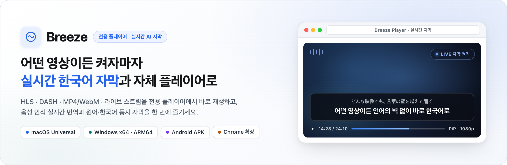

<picture>
  <source media="(prefers-color-scheme: dark)" srcset="./assets/hero-dark.png">
  <source media="(prefers-color-scheme: light)" srcset="./assets/hero-light.png">
  
</picture>

  

  
  
  

  <strong>웹 영상 실시간 음성 인식 한국어 자막 &amp; 전용 플레이어 브라우저</strong> 
  <a href="https://github.com/sungminflut/breeze-releases/releases/latest">최신 릴리스 노트</a> ·
  <a href="#설치-및-실행-안내">설치 가이드</a> ·
  <a href="https://github.com/sungminflut/breeze-releases/issues/new">문제 제보 (Issues)</a>

---

## 바로 내려받기

아래 링크를 누르면 항상 **가장 최신 안정 버전**이 바로 내려받아집니다.

| 플랫폼 | 지원 환경 | 내려받기 | 용량 |
| :--- | :--- | :--- | :---: |
| **macOS** | Apple Silicon (M1–M4) · Intel (`Universal`) | [**Breeze-mac-universal.dmg**](https://github.com/sungminflut/breeze-releases/releases/latest/download/Breeze-mac-universal.dmg) | `218 MB` |
| **Windows (x64)** | Windows 10 / 11 64-bit | [**Breeze-win-x64.exe**](https://github.com/sungminflut/breeze-releases/releases/latest/download/Breeze-win-x64.exe) | `106 MB` |
| **Windows (ARM64)** | Snapdragon / ARM 기반 Windows PC | [**Breeze-win-arm64.exe**](https://github.com/sungminflut/breeze-releases/releases/latest/download/Breeze-win-arm64.exe) | `101 MB` |
| **Android** | Android 10 이상 (`API 29+`) | [**breeze.apk**](https://github.com/sungminflut/breeze-releases/releases/latest/download/breeze.apk) | `14.9 MB` |
| **Chrome 확장** | Chrome 116+ / Chromium 브라우저 | [**breeze-extension-0.1.0.zip**](https://github.com/sungminflut/breeze-releases/releases/latest/download/breeze-extension-0.1.0.zip) | `300 KB` |

> 버전별 변경 이력과 SHA-256 체크섬은 [**Releases**](https://github.com/sungminflut/breeze-releases/releases)에서 확인할 수 있습니다.

---

## 주요 기능

- **실시간 음성 인식 한국어 자막** — 자막 파일이 없는 영상이나 해외 생방송도 오디오를 실시간으로 인식해 한국어 자막을 띄웁니다. **원어 고정**(`자동 · 일본어 · 영어 · 한국어`), **글자 크기**, **위치**(`영상 안 · 아래 · 위`), **배경**, **원문 같이 보기**를 시청 중에 바로 바꿀 수 있습니다.
- **100% 자체 Breeze 플레이어** — 사이트마다 제각각인 플레이어 대신 깔끔한 전용 플레이어에서 `HLS · DASH · MP4/WebM · 라이브 스트림`을 재생합니다. 재생 속도(`0.25x–4x`), 화질·오디오 트랙 전환, **항상 위(PiP)** 미니 창, **이어 보기**를 지원합니다.
- **원클릭 인앱 업데이트** — 새 버전이 나오면 브라우저를 다시 찾을 필요 없이 **사이드바 → 계정 → `업데이트 확인`** 한 번으로 최신 버전을 설치합니다. 시청 기록과 북마크, 이어 보기 위치는 그대로 유지됩니다.
- **프라이버시 우선 설계** — 시크릿 창을 닫으면 해당 세션의 쿠키·스토리지·캐시를 즉시 비우며, 자막 생성용 오디오는 실시간 처리 후 서버에 보관하지 않습니다. 크래시 로그도 기기 밖으로 전송하지 않습니다.

---

## 설치 및 실행 안내

Breeze는 별도 유료 코드 서명 없이 개인 개발자 서명으로 배포되므로, **첫 실행 시 OS 보안 경고 한 번만 허용**해 주시면 이후에는 바로 실행됩니다.

### macOS (`DMG`)
1. `Breeze-mac-universal.dmg`를 열고 **`Breeze.app`** 을 **`응용 프로그램(Applications)`** 폴더로 끌어다 놓습니다.
   > 앱 내 원클릭 업데이트를 사용하려면 반드시 `/Applications` 안에 설치해야 합니다.
2. 처음 열 때 보안 경고가 표시되면 **`확인`** 을 누른 뒤, **`시스템 설정 → 개인정보 보호 및 보안`** 하단의 **`그래도 열기`** 를 선택하세요.
3. 인앱 업데이트로 새 버전을 덮어쓴 뒤 로그인 정보 확인을 위해 키체인 접근 창이 뜨면 **`허용`** 을 눌러 주세요.

### Windows (`NSIS 원클릭 설치`)
1. `Breeze-win-x64.exe` *(ARM64 기기는 `Breeze-win-arm64.exe`)* 를 실행합니다.
2. Windows SmartScreen의 *"Windows의 PC 보호"* 창이 열리면 **`추가 정보 → 실행`** 을 누르세요. 관리자 권한 없이 사용자 폴더에 설치된 뒤 자동으로 실행됩니다.

### Android (`APK`)
- `breeze.apk`를 연 뒤 시스템 안내에 따라 ***"이 출처 허용(출처를 알 수 없는 앱 설치)"*** 을 켜서 설치합니다. 이후 새 버전이 나오면 앱 내 **`계정 → 업데이트 확인`** 으로 바로 설치할 수 있습니다.

### Chrome 확장 프로그램 (`선택 사항`)
기존 Chrome 브라우저의 탭에서도 Breeze 자막을 띄우고 싶을 때 사용합니다.
1. `breeze-extension-0.1.0.zip`의 압축을 풉니다.
2. Chrome 주소창에 `chrome://extensions` 를 열어 오른쪽 위 **개발자 모드**를 켭니다.
3. **`압축해제된 확장 프로그램을 로드합니다`** 를 클릭해 압축을 푼 폴더를 선택합니다.

---

## 문제 제보

재생되지 않는 사이트나 자막 오류, 설치 문제가 있다면 [**GitHub Issues**](https://github.com/sungminflut/breeze-releases/issues/new)에 **OS · 앱 버전 · 문제가 발생한 페이지 주소**를 남겨 주세요.

 

<strong>English Overview &amp; Quick Downloads</strong>

### About Breeze
**Breeze** is a media-first browser and extension with **real-time Korean AI captions** and a **unified native video player** (`HLS`, `DASH`, `MP4/WebM`, and live streams).
It extracts or captures streams cleanly into Breeze's own player (`0.25x–4x` speed, track/quality selector, Always-on-Top PiP, resume history, incognito isolation) and generates real-time Korean subtitles with optional original-language dual captions (`Auto · JA · EN · KO`).

### Downloads (Latest Release)

| Platform | Target | Download |
| :--- | :--- | :--- |
| macOS | Apple Silicon · Intel (Universal) | [Breeze-mac-universal.dmg](https://github.com/sungminflut/breeze-releases/releases/latest/download/Breeze-mac-universal.dmg) |
| Windows | x64 (Windows 10/11) | [Breeze-win-x64.exe](https://github.com/sungminflut/breeze-releases/releases/latest/download/Breeze-win-x64.exe) |
| Windows | ARM64 | [Breeze-win-arm64.exe](https://github.com/sungminflut/breeze-releases/releases/latest/download/Breeze-win-arm64.exe) |
| Android | Android 10+ (API 29+) | [breeze.apk](https://github.com/sungminflut/breeze-releases/releases/latest/download/breeze.apk) |
| Chrome | Manifest V3 (Chrome 116+) | [breeze-extension-0.1.0.zip](https://github.com/sungminflut/breeze-releases/releases/latest/download/breeze-extension-0.1.0.zip) |

### First-Launch Notes
- **macOS (ad-hoc signed):** Drag `Breeze.app` into `/Applications`. On first launch, go to **System Settings → Privacy & Security → Open Anyway**. In-app updates via **Sidebar → Account → Check for updates** require `Breeze.app` to reside in `/Applications`.
- **Windows (unsigned NSIS):** Click **More info → Run anyway** on the Windows SmartScreen prompt. Installs per-user without admin privileges.
- **Android:** Enable **Install unknown apps** for your browser/file manager when opening `breeze.apk`.
- **Chrome Extension:** Unzip and load unpacked from `chrome://extensions` with **Developer mode** enabled.

